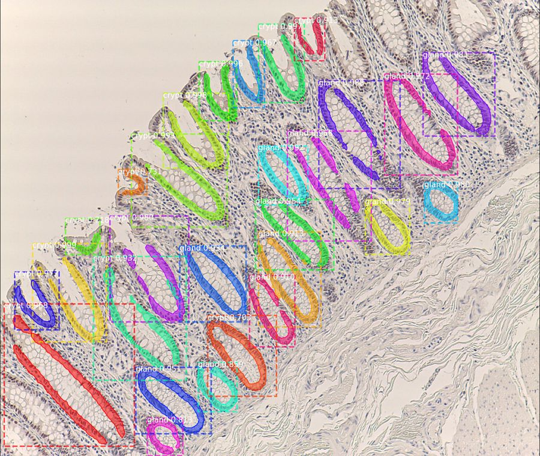
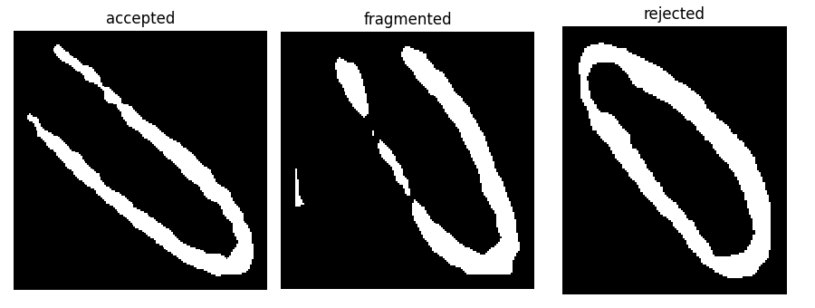
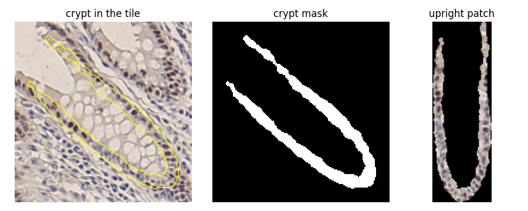
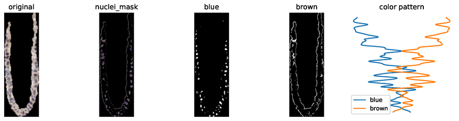
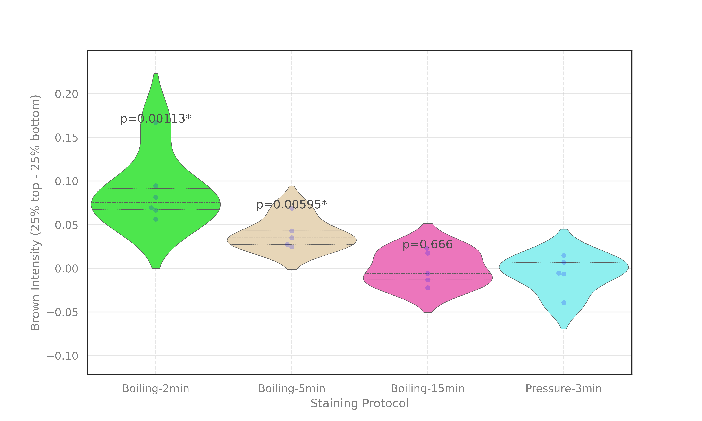

# Expression Gradient of Cancer Suppressor Gene Found in Colon Crypt Using Vision-AI

[](LICENSE)


## Introduction

This repository contains the code of the paper "Expression Gradient of Cancer Suppressor Gene Found in Colon Crypt
Using Vision-AI". A Mask R-CNN segments the crypts and glands in tiles of CDX2-stained colon tissue. Every U-shaped
crypt is then cut out of its tile and rotated upright, and the brown (CDX2) and blue nuclei are measured from the
bottom to the top of the crypt. Per slide, the brown gradient (top 25% minus bottom 25% of the crypt) is compared
between the staining protocols Pressure-3min and Boiling-2min, -5min and -15min with Welch t-tests.

The code at the top level is the TF/Keras implementation (Matterport Mask R-CNN) that trained the model and produced
the published results. [`pytorch_mrcnn/`](pytorch_mrcnn) runs the same model, with its weights converted to
PyTorch, through the same pipeline on a current software stack (Python 3.12, PyTorch 2.5, CUDA 12, NumPy 2). This
README describes both: the [TF workflow](#tf-workflow) first, then the [PyTorch workflow](#pytorch-workflow). Each
workflow starts with the installation, then training (TF) or the converted weights (PyTorch), then inference from
the raw or the processed tiles, step by step or in one command.

<p align="center">
  
  
</p>

*Left: the detections of the TF model (`models/notransfer.h5`) on a processed tile, as drawn in
`inference/inf/` (crypts and glands, with class and score). Right: the crypt masks of the same tile, one mask file
per crypt; only the crypts go through the next steps of the pipeline.*

## Table of contents

- [Introduction](#introduction)
- [Repository structure](#repository-structure)
- [Requirements](#requirements)
- [Data and models](#data-and-models)
- [TF workflow](#tf-workflow)
  - [Installation](#installation)
  - [Training](#training)
  - [Inference](#inference)
    - [Method overview](#method-overview)
    - [TF results and the inference folder](#tf-results-and-the-inference-folder)
    - [Which start point reproduces which result](#which-start-point-reproduces-which-result)
    - [Inference from the raw tiles, step by step](#inference-from-the-raw-tiles-step-by-step)
    - [Inference from the processed tiles, step by step](#inference-from-the-processed-tiles-step-by-step)
    - [Inference in one command](#inference-in-one-command)
  - [Mouse DSS analysis](#mouse-dss-analysis)
  - [Statistics and plots](#statistics-and-plots)
- [PyTorch workflow](#pytorch-workflow)
  - [PyTorch installation](#pytorch-installation)
  - [PyTorch weights](#pytorch-weights)
  - [PyTorch inference](#pytorch-inference)
    - [PyTorch input tiles](#pytorch-input-tiles)
    - [PyTorch inference from the raw tiles, step by step](#pytorch-inference-from-the-raw-tiles-step-by-step)
    - [PyTorch inference from the processed tiles, step by step](#pytorch-inference-from-the-processed-tiles-step-by-step)
    - [PyTorch inference in one command](#pytorch-inference-in-one-command)
    - [PyTorch results layout](#pytorch-results-layout)
    - [Comparison with the TF results](#comparison-with-the-tf-results)
    - [Re-running the validation against TF](#re-running-the-validation-against-tf)
  - [PyTorch mouse DSS analysis](#pytorch-mouse-dss-analysis)
- [Troubleshooting](#troubleshooting)
- [Citation](#citation)
- [License](#license)
- [Acknowledgements](#acknowledgements)
- [Contact](#contact)

## Repository structure

```
Colon_Crypt_Segmentation/
├── README.md                           this file
├── LICENSE                             Apache-2.0
├── .gitignore                          keeps data, weights, results and logs out of git
├── mrcnn/                              Mask R-CNN library (Matterport v2.1, TF1/Keras), packaging, MIT licence
├── samples/                            Matterport samples and notebooks (not used by the pipeline)
├── src/
│   ├── preprocess/
│   │   ├── color_normalize_pipe.py     P1: Reinhard colour normalisation of the raw tiles (HistomicsTK)
│   │   ├── hough_transform.py          P2: rotate every tile by minus the mean angle of its Hough lines
│   │   ├── image_extract.ipynb         cut a rectangular region out of a .czi scan (needs czifile)
│   │   ├── img_aug.py                  offline imgaug augmentation of the images of a training set and their masks
│   │   ├── resizeimg.py                resize every image of a folder to a fixed size (default 2048 x 1536)
│   │   ├── cv_technique.py             exploration: Canny edges and ellipse fit
│   │   ├── segmentation.py             exploration: watershed segmentation
│   │   └── mat_read.py                 exploration: CRCHistoPhenotypes .mat annotation files
│   ├── training/
│   │   ├── my_train_crypt.py           train the crypt/gland model (the model of the paper)
│   │   ├── my_crypts_dataset.py        its dataset loader and training configuration (CryptsConfig)
│   │   ├── my_train_gland.py           earlier gland-only model (one class), from the COCO weights
│   │   ├── my_gland_dataset.py         dataset loader of the gland-only model
│   │   ├── my_train_1.py, my_train_2.py, my_train_3.py
│   │   │                               the three stages of the nuclei recipe (Kaggle DSB 2018) the project started from
│   │   ├── my_bowl_dataset.py          dataset loader of the nuclei recipe
│   │   └── inspect_model.ipynb         Matterport notebook to inspect a trained model
│   └── inference/
│       ├── my_inference.py             step 1: detection, one mask per crypt
│       ├── u_shape_split.py            step 2: sort the crypt masks into accepted, fragmented and rejected
│       ├── ushape_bottom_up.py         step 3: cut every crypt out of its tile and stand it upright
│       ├── color_detection.py          step 4: blue and brown nuclei along every patch, final.txt per slide
│       ├── run_inference_pipeline.py   steps 1-5 in one command, with the Welch p-values
│       ├── plot_pvalues.py             step 6: Welch t-tests and violin plot of a per-slide table
│       ├── testing_data_analysis.ipynb statistics and figures of the paper (human slides and mouse DSS)
│       ├── ushape_bottom_up_mouse.py   step 3 for the mouse DSS patches (exact tile matching)
│       ├── color_detection_mouse.py    per-patch brown gradient and Welch test of the mouse DSS patches
│       └── plot_pvalues_mouse.py       violin plot and Welch p-value of the mouse DSS patches
├── dataset_preparation/
│   ├── __init__.py                     package docstring
│   └── to_grayscale.py                 turn colour annotation masks into single-channel masks, in place
├── envs/
│   ├── environment_cdx2_tf1_ref.yml         TF environment (CPU)
│   ├── environment_cdx2_tf1_gpu_ampere.yml  TF GPU environment, Ampere and newer
│   ├── environment_cdx2_tf1_gpu_cuda10.yml  TF GPU environment, CUDA 10.0 (Kepler to Turing)
│   ├── environment_histomicstk.yml          colour normalisation (P1)
│   ├── environment_plots.yml                p-values and figures of the TF workflow (step 6, mouse DSS figure)
│   ├── torch_env.yml                        PyTorch, NVIDIA GPU
│   ├── torch_env_cpu.yml                    PyTorch, Linux CPU
│   ├── torch_env_mac.yml                    PyTorch, Mac with Apple silicon (CPU)
│   ├── torch_env_macos.yml                  the packages of torch_env_mac.yml without Anaconda's defaults
│   │                                        channel (not built on a Mac; use torch_env_mac.yml)
│   ├── requirements_cdx2.txt                pip freeze of the 2019 workstation (record only, not installable)
│   └── mac_envs/                            the PyTorch environment of the Mac run, as installed:
│       ├── mac_conda_list.txt               conda list
│       ├── mac_pip_list.txt                 pip list
│       └── mac_torch_config.txt             build settings of its PyTorch (torch.__config__.show())
├── plots/
│   ├── human_tf_res_new.png            violin plot and Welch p-values of the human slides (inference/res_new.txt)
│   ├── mouse_pvalue.png                violin plot and Welch p-value of the mouse DSS patches
│   ├── human_pvalue.png, human_pvalue.svg, mouse_pvalue.svg
│   │                                   figures of the original repository (the notebook rewrites mouse_pvalue.svg)
│   └── violin_plot.jpg                 earlier figure of the original code
├── doc/images/                         images of this README, made from the published TF results and their tiles
├── dataset/                            input data                         (download; not in git)
├── models/                             trained weights                    (download; not in git)
├── inference/                          published TF results               (download; not in git)
├── logs/                               training logs and checkpoints      (not in git)
└── pytorch_mrcnn/                      PyTorch version, same layout
    ├── README.md                       pointer to the PyTorch workflow of this README
    ├── mrcnn/                          PyTorch Mask R-CNN layers: model.py config.py utils.py visualize.py (MIT)
    ├── src/
    │   ├── inference/
    │   │   ├── tfparity_maskrcnn.py        the parts of the TF model that are not learned layers (resizing,
    │   │   │                               anchors, proposals, NMS, ROI pooling, detection layer, mask unmolding)
    │   │   ├── my_inference.py             step 1
    │   │   ├── u_shape_split.py            step 2
    │   │   ├── ushape_bottom_up.py         step 3
    │   │   ├── color_detection.py          step 4
    │   │   ├── run_inference_pipeline.py   steps 1-6 in one command, then the comparison with the TF results
    │   │   ├── run_mouse_pipeline.py       the mouse DSS pipeline in one command
    │   │   └── ushape_bottom_up_mouse.py   step 3 for the mouse DSS patches (exact tile matching)
    │   ├── analysis/
    │   │   ├── build_res_table.py          step 5: per-slide table
    │   │   ├── plot_pvalues.py             step 6: Welch t-tests and violin plot
    │   │   ├── mouse_patch_statistics.py   per-patch brown gradient and Welch tests of the mouse DSS patches
    │   │   ├── mouse_patch_selection.tsv   the patch list of the stored mouse analysis
    │   │   └── plot_pvalues_mouse.py       violin plot and Welch p-value of the mouse DSS patches
    │   ├── weight_conversion/
    │   │   ├── convert_weights_to_pytorch.py  notransfer.h5 -> notransfer_torch.pth
    │   │   ├── check_weight_conversion.py     compare the two files tensor by tensor
    │   │   ├── inspect_weights.py             list the layers of a Keras .h5
    │   │   └── weight_map.txt                 its listing of notransfer.h5
    │   └── validation/                 validation scripts and checks against the TF pipeline:
    │                                   tf_reference_inference.py, run_tf_reference_downstream.sh,
    │                                   run_downstream_on_tf_masks.sh, run_checks.sh, compare_stages_with_tf.py,
    │                                   compare_tf_pytorch_results.py, check_preprocessing_parity.py,
    │                                   check_split_parity.py, check_patch_frame_shift.py
    ├── plots/
    │   ├── human_pytorch_tfparity.png         violin plot and Welch p-values of the stored PyTorch run (A100)
    │   ├── human_pytorch_tfparity_cpu.png     the same for a run on a Linux CPU
    │   ├── human_pytorch_tfparity_apple.png   the same for a run on a Mac CPU
    │   └── mouse_pytorch_tfparity.png         violin plot of the PyTorch mouse DSS patches
    ├── dataset/                        processed input tiles              (copy or link; not in git)
    ├── models/                         notransfer_torch.pth (and notransfer.h5)   (not in git)
    ├── inference/                      stored PyTorch results; Mouse/ for the mouse DSS patches   (not in git)
    └── validation/                     stored validation runs             (not in git)
```

Every script has a header (what it does, usage, author) and a `main()` with argparse, so `python <script> -h` lists
its options. The commands of the TF workflow are run from the repository root, those of the PyTorch workflow from
`pytorch_mrcnn/`: the default paths (`dataset/...`, `models/...`) are relative to the working directory. The TF
scripts add the repository root to `sys.path` themselves, so `from mrcnn import ...` works without installing the
library.

## Requirements

- **OS**: Linux x86-64 (the environment files are linux-64 builds). The PyTorch workflow also runs on a Mac with
  Apple silicon and macOS 13 or newer, on the CPU (`envs/torch_env_mac.yml`). Tested on NERSC Perlmutter (SUSE Linux
  Enterprise Server 15 SP6), October 2026.
- **CPU**: the TF environment runs on the CPU; a full run over the 626 processed tiles took 38 minutes on one 64-core
  AMD EPYC 7763 (inference 24 minutes), longer on a loaded node. The PyTorch workflow runs on a CPU with
  `--device cpu`: 34 minutes on two 64-core AMD EPYC 7763 (inference 21 minutes).
- **GPU**: optional for the TF code, with one of the [TF GPU environments](#3-tf-gpu-environments-optional)
  (TF inference took 17 minutes on one NVIDIA A100). The PyTorch workflow runs on an NVIDIA GPU with a driver for
  CUDA 12.4: a full run took 27 to 33 minutes on one NVIDIA A100-SXM4-40GB (inference 12 to 17 minutes, 1.1 to 1.6 s
  per tile), longer on a loaded node.
- **Software**: `git` and `conda` (Miniconda, Miniforge or Anaconda).
- **Disk**: raw tiles about 1.6 GB (of which 0.9 GB are the two `.czi` scans), processed tiles 3.0 GB (the PyTorch
  workflow can link to the same copy), weights 179 MB (`notransfer.h5`, and the same for `notransfer_torch.pth`); a
  full pipeline run writes about 1.6 GB (`inf/` 0.9 GB, `final/` 0.6 GB) in either workflow.

## Data and models

### Download

1. Dataset: To fill
   Put it in `dataset/`.
2. Inference dataset:To fill
   Put the raw tiles in `dataset/Whole_Slides_Segments/` and the processed tiles in
   `dataset/Whole_Slides_Segments_Processed/CDX2_Data/`.
3. Weights and published results: the model of the paper, `notransfer.h5`, and the published TF results,
   `inference/`, come from the same SharePoint location as the data (links 1 and 2 above). Put the model in
   `models/notransfer.h5`  and the results folder at the
   repository root as `inference/`.

The PyTorch weights are made from `notransfer.h5` (see [PyTorch weights](#pytorch-weights)).
Datasets, weights, results and logs are not tracked by git (see `.gitignore`).

### Expected layout

```
dataset/
├── Whole_Slides_Segments/<protocol>/<slide>/*.JPG                       raw tiles
├── Whole_Slides_Segments_Processed/CDX2_Data/<protocol>/<slide>/*.png   processed tiles: colour-normalised and
│                                                                        Hough-aligned, input of the published results
└── color_reference.png  colon.csv  gland.csv                            reference image of the colour normalisation;
                                                                         two RLE tables of the nuclei template
models/notransfer.h5                                                     model of the paper
```

The protocols are `Boiling-2min`, `Boiling-5min`, `Boiling-15min` and `Pressure-3min`.

## TF workflow

The TF/Keras code at the top level of the repository; all commands of this section are run from the repository root.

### Installation

#### 1. Clone the repository

```bash
git clone https://github.com/amitashnanda/Colon_Crypt_Segmentation.git
cd Colon_Crypt_Segmentation
```

#### 2. TF environment (CPU)

```bash
conda env create -f envs/environment_cdx2_tf1_ref.yml -p /path/to/conda_envs/cdx2_tf1_ref
/path/to/conda_envs/cdx2_tf1_ref/bin/python -m pip install --no-deps imgaug==0.4.0 imutils==0.5.4
conda activate /path/to/conda_envs/cdx2_tf1_ref
```

`imgaug` and `imutils` are installed without dependencies so that they do not pull a newer NumPy. Check the
installation:

```bash
python -c "import tensorflow as tf, keras, skimage, cv2, imgaug; print(tf.__version__, keras.__version__, skimage.__version__, cv2.__version__, imgaug.__version__)"
# 1.15.5 2.2.4 0.15.0 4.5.1 0.4.0
```

Keep the pinned versions: scikit-image 0.15 (U-shape split), OpenCV 4.5 (U-shape extraction) and imgaug 0.4.0 (input
resizing) are what the published results were computed with, and newer versions change the results.

#### 3. TF GPU environments (optional)

The CPU environment above is the reference. For an NVIDIA GPU, choose the environment by GPU generation:

| GPU | Environment file | TF / CUDA / cuDNN | NVIDIA driver |
|---|---|---|---|
| Ampere, Ada, Hopper (A100, A10, A40, L4, L40, H100, RTX 30xx/40xx); its build also has GPU code for Maxwell to Turing (GTX 9xx/10xx, P100, V100, T4, RTX 20xx) | `envs/environment_cdx2_tf1_gpu_ampere.yml` | nvidia-tensorflow 1.15.5+nv22.12 / 11.8 / 8.7 | >= 520 |
| Kepler to Turing (K80, P100, V100, T4, GTX 10xx, RTX 20xx) with an older driver | `envs/environment_cdx2_tf1_gpu_cuda10.yml` | tensorflow-gpu 1.15.5 / 10.0 / 7.6.5 | >= 410.48 |
| Blackwell (B200, RTX 50xx) | none (no TF 1.x build supports it) | | use the CPU environment |

The Ampere environment needs two steps after `conda env create`:

```bash
conda env create -f envs/environment_cdx2_tf1_gpu_ampere.yml -p /path/to/conda_envs/cdx2_tf1_gpu
/path/to/conda_envs/cdx2_tf1_gpu/bin/python -m pip install --no-deps imgaug==0.4.0 imutils==0.5.4
ln -s ../../cuda_nvrtc/lib/libnvrtc.so.11.2 \
    /path/to/conda_envs/cdx2_tf1_gpu/lib/python3.8/site-packages/nvidia/cudnn/lib/libnvrtc.so
conda activate /path/to/conda_envs/cdx2_tf1_gpu
```

`imgaug` and `imutils` go in without dependencies, as in the CPU environment. The link gives cuDNN 8.7 the unversioned
`libnvrtc.so` that it loads at the first convolution and that no pip wheel ships. `conda activate` also sets
`NVIDIA_TF32_OVERRIDE=0`: NVIDIA's TensorFlow uses TF32 arithmetic on Ampere and newer GPUs by default, which changes
the crypt masks. If you run the environment's python without `conda activate`, export `NVIDIA_TF32_OVERRIDE=0`
yourself. The environment is Python 3.8, for which scikit-image 0.15 and NumPy 1.16 do not exist; it has
scikit-image 0.16.2 and NumPy 1.21.6.

The CUDA 10 environment has the packages of the CPU environment plus tensorflow-gpu, CUDA 10.0 and cuDNN 7.6.5:

```bash
conda env create -f envs/environment_cdx2_tf1_gpu_cuda10.yml -p /path/to/conda_envs/cdx2_tf1_gpu_cuda10
/path/to/conda_envs/cdx2_tf1_gpu_cuda10/bin/python -m pip install --no-deps imgaug==0.4.0 imutils==0.5.4
conda activate /path/to/conda_envs/cdx2_tf1_gpu_cuda10
```

**Do not use the CUDA 10 environment on Ampere or newer GPUs.** On an A100 it finds the GPU, compiles for about 30
minutes and then returns wrong results without any error (0 crypts on 5 tiles that have 32).

Check a GPU environment before a run (`tf.test.is_gpu_available()` alone is not enough):

```bash
python -c "import numpy as np, tensorflow as tf; a = np.random.rand(1024, 1024).astype('float32'); p = tf.placeholder(tf.float32, a.shape); r = tf.Session().run(tf.matmul(p, p), {p: a}); print('GPU:', tf.test.is_gpu_available(), ' matmul relative error: %.1e' % (abs(r - a @ a).max() / abs(a @ a).max()))"
# GPU: True  matmul relative error: 6.3e-07
```

An error of about 1e-06 is correct; about 5e-05 means TF32 is on; about 1 means the GPU computes wrong results. Run
the pipeline as with the CPU environment, without `CUDA_VISIBLE_DEVICES=""` (that hides the GPU).

#### 4. Colour-normalisation environment (only for raw tiles)

HistomicsTK does not install into the Python 3.7 TF environment, so step P1 has its own environment:

```bash
conda env create -f envs/environment_histomicstk.yml -p /path/to/conda_envs/cdx2_histomicstk
```

#### 5. Plotting environment

Step 6 (violin plot and Welch p-values) and the mouse DSS figure are drawn by `src/inference/plot_pvalues.py` and
`src/inference/plot_pvalues_mouse.py`. They need seaborn 0.13 and matplotlib 3.10, which need Python 3.8 or newer and
therefore do not install into the TF environment, so they have their own environment (Python 3.12.13, NumPy 2.1.3,
SciPy 1.14.1, matplotlib 3.10.9, pandas 3.0.2, seaborn 0.13.2: the versions with which `plot_pvalues.py` drew
`plots/human_tf_res_new.png`):

```bash
conda env create --file envs/environment_plots.yml --prefix /path/to/conda_envs/cdx2_plots
```

#### 6. Optional: notebooks

The notebooks in `src/inference/` need seaborn and a Jupyter kernel in the TF environment
(`testing_data_analysis.ipynb` was last executed with seaborn 0.11.2 and ipykernel 6.16.2); open them with any
Jupyter front end:

```bash
python -m pip install seaborn==0.11.2 ipykernel==6.16.2
```

The same statistics and figures can be computed without Jupyter with `src/inference/plot_pvalues.py` and
`src/inference/plot_pvalues_mouse.py` in the plotting environment (see [Statistics and plots](#statistics-and-plots)).

### Training

Training runs in a TF environment of the [Installation](#installation): on the CPU in
`envs/environment_cdx2_tf1_ref.yml`, on NVIDIA GPUs in `envs/environment_cdx2_tf1_gpu_ampere.yml` (Ampere and newer)
or `envs/environment_cdx2_tf1_gpu_cuda10.yml` (Kepler to Turing; see
[TF GPU environments](#3-tf-gpu-environments-optional)).

A training set has `<dataset>/{train,valid}/Images/<name>.png`, with one mask per instance in
`Annotation/<name>_<k>.png` (crypts) and `Annotation_gland/<name>_<k>.png` (glands), for example
`dataset/Normalized_Images`. Make sure the installation is complete and the training data are downloaded; then, from
the repository root:

```
python src/training/my_train_crypt.py -h
usage: my_train_crypt.py [-h] --dataset DATASET --dest DEST [--model MODEL]

Train the crypt/gland Mask R-CNN (heads -> stage 4+ -> all layers).

optional arguments:
  -h, --help         show this help message and exit
  --dataset DATASET  path to the dataset, Exp: dataset/Normalized_Images
  --dest DEST        name of the output model, Exp:final.h5
  --model MODEL      path to the model, Exp:
                     logs/no_transfer/mask_rcnn_crypt_0060.h5

# Train a new model from scratch
python src/training/my_train_crypt.py --dataset dataset/Normalized_Images --dest final.h5

# Train a new model starting from a trained model
python src/training/my_train_crypt.py --dataset dataset/Normalized_Images --dest final.h5 --model models/notransfer.h5
```

The schedule is: heads to epoch 1 with light augmentation, ResNet stage 4 and up to epoch 20 without augmentation,
all layers to epoch 30 with strong augmentation; Python, NumPy and TensorFlow are seeded with 123. The number of GPUs
is not an option of the script: `CryptsConfig` in `src/training/my_crypts_dataset.py` trains on 4 GPUs with one image
each (`GPU_COUNT = 4`, `IMAGES_PER_GPU = 1`); change `GPU_COUNT` there for another number of GPUs, and set it to 1
for training on the CPU (the Matterport library requires 1 when only a CPU is used). Checkpoints are
written to `logs/crypt<timestamp>/` and the final weights to `logs/crypt<timestamp>/<dest>`.
`src/training/inspect_model.ipynb` is the Matterport notebook for inspecting a trained model; its paths still follow
the original repository layout.

### Inference

The inference pipeline turns tiles into crypt masks, upright crypt patches, colour profiles, a per-slide table and the
Welch p-values with their violin plot. It starts from the raw tiles or from the processed tiles; the published
results were computed from the processed tiles. All commands run from the repository root, and each run writes a new
output folder.

#### Method overview

```
raw tiles (.JPG) ─► P1 colour normalisation ─► P2 Hough alignment ─► processed tiles (.png)
processed tiles  ─► 1 Mask R-CNN ─► 2 U-shape split ─► 3 U-shape extraction ─► 4 colour detection
                 ─► 5 per-slide table ─► 6 Welch t-tests and violin plot
```

| Step | Script | Output |
|---|---|---|
| P1 colour normalisation | `src/preprocess/color_normalize_pipe.py` | Reinhard-normalised tiles (HistomicsTK), written as .png |
| P2 Hough alignment | `src/preprocess/hough_transform.py` | tiles rotated by minus the mean Hough-line angle: the processed tiles |
| 1 detection | `src/inference/my_inference.py` | `inf/<protocol>/<slide>/predicted_images/` (drawings) and `predicted_mask/` (one mask per crypt) |
| 2 U-shape split | `src/inference/u_shape_split.py` | `us_split/<protocol>/<slide>/{accepted,fragmented,rejected}/` |
| 3 U-shape extraction | `src/inference/ushape_bottom_up.py` | `us_final/<protocol>/<slide>/{accepted,fragmented}/`: upright crypt patches |
| 4 colour detection | `src/inference/color_detection.py` | `final/<protocol>/<slide>/final.txt` (+ nuclei masks and PDFs) |
| 5 per-slide table | `src/inference/run_inference_pipeline.py` | `res_new.txt`: one row per human slide |
| 6 statistics | `src/inference/plot_pvalues.py` or `src/inference/testing_data_analysis.ipynb` | Welch p-values and the violin plot |

- **Model**: Mask R-CNN (Matterport v2.1, `mrcnn/`) with a ResNet-50 FPN backbone and three classes (background,
  crypt, gland); training script `src/training/my_train_crypt.py`. The model of the paper is `models/notransfer.h5`.
- **Detection** (step 1): each tile is padded to the aspect ratio 1.5 and resized to 1024 x 768; detections need a
  score of at least 0.7 (NMS 0.4, at most 512 per tile); one 0/255 mask is written per crypt (class 1), as in the
  images at the top of this README.
- **U-shape split** (step 2): every crypt mask is sorted by the end points of its skeleton, its connected components
  and its large holes into accepted (one piece, a clean U), fragmented (a U in pieces or with extra branches) and
  rejected (closed O shapes, noise and unclear cases). Steps 3 and 4 use the accepted and the fragmented crypts.

  <p align="center"></p>

- **U-shape extraction** (step 3): an ellipse is fitted to the mask, the mask and the tile are rotated so that the
  crypt stands upright with its opening at the top (bottom up), and the tile pixels under the mask are cropped to the
  crypt.

  <p align="center"></p>

- **Colour measurement** (step 4): each patch is resized to 400 x 1200, reduced to its nuclei (Otsu threshold) and
  split into blue (hue 80-140) and brown (hue 0-40 or 150-180) pixels; per row the two counts are normalised to sum
  to 1. `final.txt` holds the number of crypts of a slide and the means of its summed blue and brown profiles over the
  top and bottom 50% and 25% of the crypt height.

  <p align="center"></p>

  *The figure of step 4 for the same crypt (`final/.../blue_brown_mask/`): the upright patch, its nuclei, the blue
  and the brown nuclei, and the blue and brown profiles along the crypt.*

- **Statistic** (steps 5 and 6): per slide, brown top 25% minus brown bottom 25%, divided by the number of crypts;
  Pressure-3min is compared with each Boiling protocol (Welch t-test, unequal variances).

#### TF results and the inference folder

The published TF results, `inference/` (see [Download](#download)), have this layout; a run of the pipeline writes
the same folders into its output folder:

```
inference/
├── inf/<protocol>/<slide>/predicted_images/   step 1: drawing of the detections of every tile, <tile>.png
├── inf/<protocol>/<slide>/predicted_mask/     step 1: one 0/255 mask per crypt, <tile>_<j>.png
├── us_split/<protocol>/<slide>/{accepted,fragmented,rejected}/
│                                              step 2: the crypt masks, sorted
├── us_final/<protocol>/<slide>/{accepted,fragmented}/
│                                              step 3: upright crypt patches
├── final/<protocol>/<slide>/                  step 4: final.txt, the nuclei masks (mask_and/) and the colour
│                                              figures (blue_brown_mask/, one PDF per patch; all_in_one.pdf)
├── res_new.txt                                step 5: per-slide table of the paper
└── Mouse/                                     mouse DSS patches and their results (see Mouse DSS analysis)
```

`res_new.txt` has one row per human slide (21), without a header: the protocol, the number of measured crypts and
the means of the summed blue and brown profiles over the top and bottom 50% and 25% of the crypt height (blue top
50%, blue bottom 50%, blue top 25%, blue bottom 25%, then the same for brown). The published result is
Welch p = 0.00113 (Pressure-3min against Boiling-2min), 0.00595 (against Boiling-5min) and 0.666 (against
Boiling-15min), with the figure `plots/human_tf_res_new.png`:

<p align="center"></p>

#### Which start point reproduces which result

The published results were computed from the processed tiles in `CDX2_Data`: start there to reproduce them. Starting
from the raw tiles goes through P1 and P2, which give slightly different processed tiles, so the numbers differ
slightly. The stored intermediate folders of `inference/` can also be the start point (see
[Inference in one command](#inference-in-one-command)):

| Start from | Steps | Welch p (Boiling-2min, 5min, 15min) |
|---|---|---|
| published table, `inference/res_new.txt` | 6 | 0.00113, 0.00595, 0.666 |
| stored crypt patches, `inference/us_final` | 4-6 | 0.00113, 0.00595, 0.666 (`res_new.txt` byte for byte) |
| stored crypt masks, `inference/inf` | 2-6 | 0.000988, 0.00581, 0.666 |
| processed tiles, `CDX2_Data` | 1-6 | 0.00102, 0.00624, 0.665 |
| raw tiles, `Whole_Slides_Segments` | P1, P2, 1-6 | slightly different from the published values |

From the processed tiles or the stored masks every slide keeps its number of measured crypts, but the values move
slightly: from the processed tiles a few crypt masks come out a few pixels different (floating-point differences
between machines), and in both cases the U-shape step fits its ellipse to a random, unseeded subsample of the mask for
crypts larger than 8,000 pixels; the p-values therefore move in the second or third digit.

#### Inference from the raw tiles, step by step

| Step | Script | Environment | Input | Output |
|---|---|---|---|---|
| P1 colour normalisation | `src/preprocess/color_normalize_pipe.py` | colour normalisation | `dataset/Whole_Slides_Segments/` (raw tiles, .JPG) | `dataset/Color_Normalized/` |
| P2 Hough alignment | `src/preprocess/hough_transform.py` | TF | `dataset/Color_Normalized/` | `dataset/Hough_Aligned/` |
| 1 detection | `src/inference/my_inference.py` | TF | `dataset/Hough_Aligned/` | `inference_raw/inf/` |
| 2 U-shape split | `src/inference/u_shape_split.py` | TF | `inference_raw/inf/` | `inference_raw/us_split/` |
| 3 U-shape extraction | `src/inference/ushape_bottom_up.py` | TF | `inference_raw/us_split/` and `dataset/Hough_Aligned/` | `inference_raw/us_final/` |
| 4 colour detection | `src/inference/color_detection.py` | TF | `inference_raw/us_final/` | `inference_raw/final/` |
| 5 per-slide table and p-values | `src/inference/run_inference_pipeline.py --start table` | TF | `inference_raw/final/` | `inference_raw/res_new.txt` |
| 6 violin plot and p-values | `src/inference/plot_pvalues.py` | plotting | `inference_raw/res_new.txt` | `inference_raw/plots/human_tf_raw.png` |

```bash
# P1. colour normalisation (colour-normalisation environment)
conda activate /path/to/conda_envs/cdx2_histomicstk
python src/preprocess/color_normalize_pipe.py --ref dataset/color_reference.png \
    --src dataset/Whole_Slides_Segments/ --dest dataset/Color_Normalized/
# P2. Hough alignment (TF environment)
conda activate /path/to/conda_envs/cdx2_tf1_ref
python src/preprocess/hough_transform.py --src dataset/Color_Normalized/ --dest dataset/Hough_Aligned/
# 1-4. detection, U-shape split, U-shape extraction, colour detection (TF environment)
TILES=dataset/Hough_Aligned; OUT=inference_raw
python src/inference/my_inference.py --src $TILES/ --dest $OUT/inf/ --model models/notransfer.h5
python src/inference/u_shape_split.py --inf_root $OUT/inf --out_root $OUT/us_split
python src/inference/ushape_bottom_up.py --us_split_root $OUT/us_split --original_root $TILES --output_root $OUT/us_final
python src/inference/color_detection.py --src $OUT/us_final --dest $OUT/final
# 5. per-slide table and Welch p-values (TF environment)
python src/inference/run_inference_pipeline.py --dest $OUT --start table
# 6. violin plot with the p-values (plotting environment)
conda activate /path/to/conda_envs/cdx2_plots
python src/inference/plot_pvalues.py --res $OUT/res_new.txt --out $OUT/plots/human_tf_raw.png
```

P1 mirrors the folder tree of `--src` under `--dest` and writes every image (.jpg, .jpeg, .png, .tif, .tiff) as .png;
P2 reads only .png files, and `--show` also displays its intermediate images (needs a display). This path gives
slightly different numbers than the published ones (see
[Which start point reproduces which result](#which-start-point-reproduces-which-result)).

#### Inference from the processed tiles, step by step

The processed tiles, `dataset/Whole_Slides_Segments_Processed/CDX2_Data`, are colour-normalised and Hough-aligned:
the published results were computed from them. Starting from them, the steps are:

| Step | Script | Environment | Input | Output |
|---|---|---|---|---|
| 1 detection | `src/inference/my_inference.py` | TF | `dataset/Whole_Slides_Segments_Processed/CDX2_Data/` | `inference_run/inf/` |
| 2 U-shape split | `src/inference/u_shape_split.py` | TF | `inference_run/inf/` | `inference_run/us_split/` |
| 3 U-shape extraction | `src/inference/ushape_bottom_up.py` | TF | `inference_run/us_split/` and the processed tiles | `inference_run/us_final/` |
| 4 colour detection | `src/inference/color_detection.py` | TF | `inference_run/us_final/` | `inference_run/final/` |
| 5 per-slide table and p-values | `src/inference/run_inference_pipeline.py --start table` | TF | `inference_run/final/` | `inference_run/res_new.txt` |
| 6 violin plot and p-values | `src/inference/plot_pvalues.py` | plotting | `inference_run/res_new.txt` | `inference_run/plots/human_tf_run.png` |

```bash
conda activate /path/to/conda_envs/cdx2_tf1_ref
TILES=dataset/Whole_Slides_Segments_Processed/CDX2_Data; OUT=inference_run
# 1. detection: predicted_images/ and predicted_mask/ per slide
python src/inference/my_inference.py --src $TILES/ --dest $OUT/inf/ --model models/notransfer.h5
# 2. split the crypt masks into accepted / fragmented / rejected
python src/inference/u_shape_split.py --inf_root $OUT/inf --out_root $OUT/us_split
# 3. upright crypt patches of the accepted and fragmented crypts
python src/inference/ushape_bottom_up.py --us_split_root $OUT/us_split --original_root $TILES --output_root $OUT/us_final
# 4. colour profiles and final.txt per slide
python src/inference/color_detection.py --src $OUT/us_final --dest $OUT/final
# 5. per-slide table and Welch p-values
python src/inference/run_inference_pipeline.py --dest $OUT --start table
# 6. violin plot with the p-values (plotting environment)
conda activate /path/to/conda_envs/cdx2_plots
python src/inference/plot_pvalues.py --res $OUT/res_new.txt --out $OUT/plots/human_tf_run.png
```

The step scripts add to existing folders instead of replacing them, so write each run into a new folder. Compare the
figure of the run with the figure of the paper, `plots/human_tf_res_new.png`; on the published table, step 6 gives
that figure byte for byte:

```bash
python src/inference/plot_pvalues.py --res inference/res_new.txt --out inference_run/plots/human_tf_res_new.png
cmp inference_run/plots/human_tf_res_new.png plots/human_tf_res_new.png && echo "identical to the figure of the paper"
```

#### Inference in one command

`src/inference/run_inference_pipeline.py` runs steps 1 to 5 with the step scripts and prints the Welch p-values;
`src/inference/plot_pvalues.py` then draws the figure (step 6). From the processed tiles (about 40 minutes on a 64-core
CPU):

```bash
conda activate /path/to/conda_envs/cdx2_tf1_ref
python src/inference/run_inference_pipeline.py --dest inference_run
conda activate /path/to/conda_envs/cdx2_plots
python src/inference/plot_pvalues.py --res inference_run/res_new.txt --out inference_run/plots/human_tf_run.png
```

The run writes `inference_run/{inf,us_split,us_final,final,logs}/` and `inference_run/res_new.txt`, and prints at
the end:

```
== table
   21 slides -> .../inference_run/res_new.txt
   Pressure-3min vs Boiling-2min   Welch p = 0.00102
   Pressure-3min vs Boiling-5min   Welch p = 0.00624
   Pressure-3min vs Boiling-15min  Welch p = 0.665
```

The published values are 0.00113, 0.00595 and 0.666 (see
[Which start point reproduces which result](#which-start-point-reproduces-which-result)); in the Ampere GPU
environment the same run printed 0.000986, 0.00579 and 0.667. From the raw tiles, run P1 and P2 of
[Inference from the raw tiles](#inference-from-the-raw-tiles-step-by-step) first, then the runner with
`--src dataset/Hough_Aligned`.

```
usage: run_inference_pipeline.py [-h] [--src SRC] --dest DEST [--model MODEL] [--table TABLE]
                                 [--start {inference,split,ushape,color,table}] [--jobs JOBS] [--overwrite]
```

| Option | Default | Meaning |
|---|---|---|
| `--src` | `dataset/Whole_Slides_Segments_Processed/CDX2_Data` | processed tiles, `<src>/<protocol>/<slide>/<tile>.png` |
| `--dest` | (required) | output root; gets `inf/ us_split/ us_final/ final/ logs/` and the table |
| `--model` | `models/notransfer.h5` | Keras weights |
| `--table` | `res_new.txt` | name of the per-slide table written in `--dest` |
| `--start` | `inference` | first step to run; the folder of the step before it must already be in `--dest` |
| `--jobs` | `4` | parallel processes for steps 3 and 4 (one per protocol) |
| `--overwrite` | off | delete existing outputs of the steps that will run |

Existing outputs are never replaced without `--overwrite`, so the published results in `inference/` stay intact as
long as `--dest` is another folder. The output of every step goes to `<dest>/logs/`.

`--start` reuses the folder of the step before it from `--dest`; to start from the published intermediate results,
link the published folder there. From the stored crypt patches (7 to 12 minutes) the runner recomputes the published
table exactly:

```bash
# from the stored crypt masks (steps 2-5)
mkdir -p inference_split && ln -s ../inference/inf inference_split/inf
python src/inference/run_inference_pipeline.py --dest inference_split --start split
# from the stored crypt patches (steps 4-5): reproduces inference/res_new.txt byte for byte
mkdir -p inference_check && ln -s ../inference/us_final inference_check/us_final
python src/inference/run_inference_pipeline.py --dest inference_check --start color
# only the table and the p-values, from the stored final/ folder
mkdir -p inference_table && ln -s ../inference/final inference_table/final
python src/inference/run_inference_pipeline.py --dest inference_table --start table
```

```bash
cmp inference_check/res_new.txt inference/res_new.txt && echo "identical to the published table"
```

### Mouse DSS analysis

The mouse DSS experiment compares boiling and pressure on patches of mouse colon. It runs with the TF code: P1, then
steps 1-4 on flat folders of patches, then the per-patch statistics. Its stored data are in `inference/Mouse/`; for
X = `b` (boiling) or `p` (pressure):

| Folder or file | Content |
|---|---|
| `<set>/patch_X_final/` | the input patches (boiling 52, pressure 27) |
| `<set>/patch_X_nm/`, `patch_X_inf/`, `patch_X_split/`, `patch_X_us/`, `final/` | P1, then steps 1 to 4 (49 boiling and 45 pressure crypts) |
| `res_mouse.txt` | the data rows of the two `final.txt`, first column renamed `boiling` and `pressure` |
| `boiling/patch_b_us_copy/` | the 39 boiling patches used by the stored statistics |
| `per_image_brown_intensity.tsv`, `summary_and_pvalue.tsv`, `violin_boiling_vs_pressure.png` | `color_detection_mouse.py` on `boiling/patch_b_us_copy` and `pressure/patch_p_us` |
| `testing/` | earlier patch sets, not used by the pipeline |

**Step 3 for the mouse patches.** `src/inference/ushape_bottom_up.py` gives each tile every mask that matches
`glob(<tile>_*.png)`. The mouse patch names extend each other (`patch_0001.png`, `patch_0001_p1.png`,
`patch_0001_p1_pr.png`), so a tile also receives the masks of other tiles; the patch is then cut from the wrong field
of view, and the version written last in `os.listdir` order is kept. The stored results were made with this script.
`src/inference/ushape_bottom_up_mouse.py` is the same script with one change: a mask `<tile>_<j>.png` is cut only
from `<tile>.png`. It takes the options of `ushape_bottom_up.py`.

Run the pipeline into a new folder, `mouse_run/` (never `inference/`). P1, in the colour-normalisation environment:

```bash
python src/preprocess/color_normalize_pipe.py --ref dataset/color_reference.png \
    --src inference/Mouse/boiling/patch_b_final --dest mouse_run/boiling/patch_b_nm
python src/preprocess/color_normalize_pipe.py --ref dataset/color_reference.png \
    --src inference/Mouse/pressure/patch_p_final --dest mouse_run/pressure/patch_p_nm
```

Steps 1-4, in the TF environment, for the boiling set; then run the same lines again with `SET=pressure; X=p`:

```bash
SET=boiling; X=b; R=mouse_run/$SET
python src/inference/my_inference.py --src $R/patch_${X}_nm --dest $R/patch_${X}_inf --model models/notransfer.h5
python src/inference/u_shape_split.py --inf_root $R/patch_${X}_inf --out_root $R/patch_${X}_split
python src/inference/ushape_bottom_up_mouse.py --us_split_root $R/patch_${X}_split --original_root $R/patch_${X}_nm \
    --output_root $R/patch_${X}_us
python src/inference/color_detection.py --src $R/patch_${X}_us --dest $R/final
```

To repeat step 3 as the stored results were made, run `ushape_bottom_up.py` with the same options. Then the per-set
table and the per-patch statistics, in the TF environment:

```bash
for s in boiling pressure; do sed -n 2p mouse_run/$s/final/final.txt | sed "s/^[^[:space:]]*/$s/"; done > mouse_run/res_mouse.txt
python src/inference/color_detection_mouse.py --boiling_root mouse_run/boiling/patch_b_us \
    --pressure_root mouse_run/pressure/patch_p_us --out mouse_run
```

```
usage: color_detection_mouse.py [-h] --boiling_root BOILING_ROOT --pressure_root PRESSURE_ROOT --out OUT [--plot]

  --boiling_root BOILING_ROOT    Path to boiling root (contains patch_b_us) OR directly to patch_b_us
  --pressure_root PRESSURE_ROOT  Path to pressure root (contains patch_p_us) OR directly to patch_p_us
  --out OUT                      Output directory for TSVs (and optional plot)
  --plot                         Save violin+swarm plot
```

`color_detection_mouse.py` measures the brown intensity of the top 25% minus the bottom 25% of every patch and writes
`per_image_brown_intensity.tsv` (one value per patch, in file-system order) and `summary_and_pvalue.tsv` (counts,
means and the Welch test); `--plot` also draws `violin_boiling_vs_pressure.png` and needs seaborn (see
[Optional: notebooks](#6-optional-notebooks)); without it the plot is skipped with a warning. On your own run it
measures all patches; the stored statistics use the patches in `boiling/patch_b_us_copy`. Recompute the stored
tables from the stored patches with:

```bash
python src/inference/color_detection_mouse.py --boiling_root inference/Mouse/boiling/patch_b_us_copy \
    --pressure_root inference/Mouse/pressure/patch_p_us --out mouse_run/stored_tables --plot
```

Pass the boiling folder itself: given `inference/Mouse/boiling` as the root, the script takes `patch_b_us`, not
`patch_b_us_copy`, which the stored tables come from.

The mouse cells of `src/inference/testing_data_analysis.ipynb` read the stored `per_image_brown_intensity.tsv`, drop
four of its rows by position and give p = 0.0385. The figure
of the mouse analysis is `plots/mouse_pvalue.png`, the figure of the notebook's mouse cells. Without Jupyter,
`src/inference/plot_pvalues_mouse.py` draws it from a per-patch table, in the plotting environment; it drops the same
four patches by file name, so it also works on a table whose rows are in another order:

```bash
conda activate /path/to/conda_envs/cdx2_plots
python src/inference/plot_pvalues_mouse.py --tsv inference/Mouse/per_image_brown_intensity.tsv --out mouse_run/plots/mouse_pvalue.png
python src/inference/plot_pvalues_mouse.py --tsv mouse_run/per_image_brown_intensity.tsv --out mouse_run/plots/mouse_tf_run.png
```

On the stored table it prints p = 0.0385 and draws the figure of `plots/mouse_pvalue.png` with the same colours and
layout; it is drawn with newer matplotlib and seaborn than the stored file, so the two files are not byte-identical.
For crypts larger than 8,000 pixels (43 of the 95 mouse crypts) the U-shape step fits its ellipse to a random,
unseeded subsample, so about half of the mouse patches change from run to run.

### Statistics and plots

`src/inference/testing_data_analysis.ipynb` computes the statistics and figures of the paper, and it stays as it is.
Its human cells read `inference/res_new.txt`, divide by the number of crypts, take brown top 25% minus bottom 25% per
slide, run the Welch t-tests of Pressure-3min against each Boiling protocol and draw the violin plot
(`plots/violin_plot.svg`); its mouse cells do the same for the mouse patches (`plots/mouse_pvalue.svg`). Start Jupyter
in the repository root, or run `%cd ../..` first if it starts in `src/inference/`; it needs the notebook extras of the
TF environment ([Optional: notebooks](#6-optional-notebooks)).

The scripts `src/inference/plot_pvalues.py` (the human cells) and `src/inference/plot_pvalues_mouse.py` (the mouse
cells) compute the same without Jupyter, in the plotting environment:

```bash
conda activate /path/to/conda_envs/cdx2_plots
python src/inference/plot_pvalues.py --res inference/res_new.txt --out inference_run/plots/human_tf_res_new.png
cmp inference_run/plots/human_tf_res_new.png plots/human_tf_res_new.png && echo "identical to the figure of the paper"
python src/inference/plot_pvalues_mouse.py --tsv inference/Mouse/per_image_brown_intensity.tsv --out mouse_run/plots/mouse_pvalue.png
```

On `inference/res_new.txt`, `plot_pvalues.py` prints p = 0.00113, 0.00595 and 0.666 and writes a file byte-identical
to `plots/human_tf_res_new.png`; it needs a table with all four protocols, and with fewer it stops with a `ValueError`.
`plot_pvalues_mouse.py` prints the Welch p-value of the 80 remaining patches (0.0385 on the stored table);
`--exclude` sets other patches to leave out. `violin_plot.svg` is written by the notebook and is not in the
repository until the notebook runs.

## PyTorch workflow

[`pytorch_mrcnn/`](pytorch_mrcnn) runs the same model, with the TF weights converted to PyTorch, through the same
steps, on the same input tiles and with the same output layout. It reproduces the TF results (the same number of
measured crypts on every slide, p = 0.00112, 0.00584 and 0.665 against TF's 0.00113, 0.00595 and 0.666), and it is
deterministic: on an NVIDIA GPU with `envs/torch_env.yml`, a re-run gives the stored PyTorch results in
`pytorch_mrcnn/inference/` exactly (byte for byte, the plot pixel for pixel). All commands of this section are run
from `pytorch_mrcnn/`. By default its scripts read the processed tiles from `pytorch_mrcnn/dataset/`; the commands
below pass `--src ../dataset/Whole_Slides_Segments_Processed/CDX2_Data` to read the copy at the repository root
instead (a run with the root copy reproduced the stored PyTorch results exactly).

### PyTorch installation

1. In the clone of the repository (see [Installation](#installation)), change into the PyTorch folder:
   ```bash
   cd Colon_Crypt_Segmentation/pytorch_mrcnn
   ```
2. Create the environment; every package that affects the results is pinned. For an NVIDIA GPU:
   ```bash
   conda env create --file ../envs/torch_env.yml --prefix /path/to/conda_envs/torch_env
   conda activate /path/to/conda_envs/torch_env
   ```
   On a Linux machine without an NVIDIA GPU, use the CPU environment (the same versions, with the CPU-only build of
   PyTorch) and add `--device cpu` to the commands of `run_inference_pipeline.py`, `my_inference.py` and
   `run_mouse_pipeline.py` below:
   ```bash
   conda env create --file ../envs/torch_env_cpu.yml --prefix /path/to/conda_envs/torch_env_cpu
   conda activate /path/to/conda_envs/torch_env_cpu
   ```
   On a Mac with Apple silicon and macOS 13 or newer, use the Mac environment (the same versions, with the macOS
   build of PyTorch) and add `--device cpu` to the same commands:
   ```bash
   conda env create --file ../envs/torch_env_mac.yml --prefix /path/to/conda_envs/torch_env_mac
   conda activate /path/to/conda_envs/torch_env_mac
   ```
   A CPU run gives the conclusions of the stored GPU run, with other numbers: p = 0.00118, 0.00644 and
   0.666 on a Linux CPU (`pytorch_mrcnn/plots/human_pytorch_tfparity_cpu.png`) and 0.00245, 0.000888 and 0.604 on a
   Mac (`pytorch_mrcnn/plots/human_pytorch_tfparity_apple.png`), against 0.00112, 0.00584 and 0.665 on the A100 of the
   stored run.
3. Check it (on a GPU node the last value is `True`):
   ```bash
   python -c "import torch, cv2, skimage, numpy; print(torch.__version__, torch.version.cuda, cv2.__version__, skimage.__version__, numpy.__version__, torch.cuda.is_available())"
   # 2.5.1 12.4 4.13.0 0.26.0 2.1.3 True     (CPU environment or Mac: 2.5.1 None 4.13.0 0.26.0 2.1.3 False)
   ```
4. Only for re-running the validation against TF: the TF environment (`../envs/environment_cdx2_tf1_ref.yml`, see
   [Installation](#installation)).

### PyTorch weights

Training is done with the TF code ([Training](#training)); the trained `.h5` is then converted. The PyTorch workflow
uses `models/notransfer_torch.pth` in `pytorch_mrcnn/`, made from the TF weights `../models/notransfer.h5` (downloaded
as in [Data and models](#data-and-models)). If it is not there yet, create and check it:

```bash
python src/weight_conversion/convert_weights_to_pytorch.py --keras_model ../models/notransfer.h5 \
    --pytorch_model models/notransfer_torch.pth --backbone resnet50
python src/weight_conversion/check_weight_conversion.py --h5 ../models/notransfer.h5 --pth models/notransfer_torch.pth
```

The file of the stored PyTorch results is 178,790,998 bytes with MD5 `2b2a03b9c64576ff40eba52546888c2f`. A converted
file has the same 384 tensors but another MD5, because PyTorch writes a new serialization id into every saved file.
The TF results that the PyTorch runs are compared with are the published `inference/` at the repository root
(item 3 of [Download](#download)).

To check an existing `models/notransfer_torch.pth` against the TF weights, convert again into a new file and check
it:

```bash
python src/weight_conversion/convert_weights_to_pytorch.py --keras_model ../models/notransfer.h5 \
    --pytorch_model models/notransfer_torch_reconverted.pth --backbone resnet50
python src/weight_conversion/check_weight_conversion.py --h5 ../models/notransfer.h5 --pth models/notransfer_torch_reconverted.pth
```

Write the re-converted weights to a new file, as above, rather than over `models/notransfer_torch.pth`, whose MD5
identifies the file of the stored results.

The check loads the `.pth` into the PyTorch model with strict key checking and compares every tensor with the `.h5`;
it ends with:

```
compared 384 tensors with the .h5; largest |difference| = 0 (None)
keras tensors not used by the PyTorch model: 0 []
total parameters in .pth: 44,668,324
RESULT: conversion is exact
```

`src/weight_conversion/inspect_weights.py --weights ../models/notransfer.h5` lists the layers of a Keras `.h5`
(`weight_map.txt` is its listing of `notransfer.h5`).

The training code of the port in `mrcnn/model.py` was not used for this model.

### PyTorch inference

The learned layers (ResNet-50 FPN, RPN, classifier and mask heads) come from a PyTorch Mask R-CNN port
(`pytorch_mrcnn/mrcnn/model.py`). Everything that is not a learned layer (input resizing, anchors, proposals, NMS,
ROI pooling, detection layer, mask unmolding) is implemented in `pytorch_mrcnn/src/inference/tfparity_maskrcnn.py`
after the TF code, and the GPU runs with TF32 off and deterministic cuDNN. The downstream steps are the TF scripts
with the effects of newer libraries removed (scikit-image 0.15 small-object rule in the split; imgaug-exact resizing,
OpenCV 4.5 behaviour for empty image halves and a seeded point subsample in the U-shape extraction). The colour
detection is the TF code.

#### PyTorch input tiles

The PyTorch pipeline reads the processed (colour-normalised, Hough-aligned) tiles, the same 626 tiles as the TF code.
Download them as described in [Data and models](#data-and-models). The commands below read them from the repository
root with `--src ../dataset/...`; the validation scripts expect them under `pytorch_mrcnn/dataset/`, as a copy or as
a link to the copy at the repository root:

```bash
mkdir -p dataset
ln -s ../../dataset/Whole_Slides_Segments_Processed dataset/Whole_Slides_Segments_Processed
```

The stored PyTorch results were computed from these processed tiles.

#### PyTorch inference from the raw tiles, step by step

The preprocessing is that of the TF workflow: run P1 and P2 of
[Inference from the raw tiles](#inference-from-the-raw-tiles-step-by-step) from the repository root (colour-normalisation
and TF environments), which write `dataset/Hough_Aligned/`. Then, in the PyTorch environment, from `pytorch_mrcnn/`:

| Step | Script (in `pytorch_mrcnn/`) | Input | Output |
|---|---|---|---|
| 1 detection | `src/inference/my_inference.py` | `../dataset/Hough_Aligned/` | `inference_raw/inf/` |
| 2 U-shape split | `src/inference/u_shape_split.py` | `inference_raw/inf/` | `inference_raw/us_split/` |
| 3 U-shape extraction | `src/inference/ushape_bottom_up.py` | `inference_raw/us_split/` and `../dataset/Hough_Aligned/` | `inference_raw/us_final/` |
| 4 colour detection | `src/inference/color_detection.py` | `inference_raw/us_final/` | `inference_raw/final/` |
| 5 per-slide table | `src/analysis/build_res_table.py` | `inference_raw/final/` | `inference_raw/res_tfparity.txt` |
| 6 violin plot and p-values | `src/analysis/plot_pvalues.py` | `inference_raw/res_tfparity.txt` | `inference_raw/plots/human_pytorch_raw.png` |

```bash
conda activate /path/to/conda_envs/torch_env
cd Colon_Crypt_Segmentation/pytorch_mrcnn
TILES=../dataset/Hough_Aligned; OUT=inference_raw
python src/inference/my_inference.py --src $TILES --dest $OUT/inf --weights models/notransfer_torch.pth
python src/inference/u_shape_split.py --inf_root $OUT/inf --out_root $OUT/us_split
python src/inference/ushape_bottom_up.py --us_split_root $OUT/us_split --original_root $TILES --output_root $OUT/us_final
python src/inference/color_detection.py --src $OUT/us_final --dest $OUT/final
python src/analysis/build_res_table.py --final_root $OUT/final --out $OUT/res_tfparity.txt
python src/analysis/plot_pvalues.py --res $OUT/res_tfparity.txt --out $OUT/plots/human_pytorch_raw.png
```

As in the TF workflow, raw tiles preprocessed today are not the published input tiles, so the numbers differ slightly
from the published ones (see [Which start point reproduces which result](#which-start-point-reproduces-which-result)).

#### PyTorch inference from the processed tiles, step by step

The same steps on the processed tiles of the repository root; the stored PyTorch results were computed from them, and
the final figure of the stored run is `plots/human_pytorch_tfparity.png`:

| Step | Script (in `pytorch_mrcnn/`) | Input | Output |
|---|---|---|---|
| 1 detection | `src/inference/my_inference.py` | `../dataset/Whole_Slides_Segments_Processed/CDX2_Data/` | `inference_run/inf/` |
| 2 U-shape split | `src/inference/u_shape_split.py` | `inference_run/inf/` | `inference_run/us_split/` |
| 3 U-shape extraction | `src/inference/ushape_bottom_up.py` | `inference_run/us_split/` and the processed tiles | `inference_run/us_final/` |
| 4 colour detection | `src/inference/color_detection.py` | `inference_run/us_final/` | `inference_run/final/` |
| 5 per-slide table | `src/analysis/build_res_table.py` | `inference_run/final/` | `inference_run/res_tfparity.txt` |
| 6 violin plot and p-values | `src/analysis/plot_pvalues.py` | `inference_run/res_tfparity.txt` | `inference_run/plots/human_pytorch_tfparity.png` |

```bash
CDX=../dataset/Whole_Slides_Segments_Processed/CDX2_Data; OUT=inference_run
# 1. masks and drawings (the mouse slide folder is skipped by default)
python src/inference/my_inference.py --src $CDX --dest $OUT/inf --weights models/notransfer_torch.pth
# 2. split into accepted / fragmented / rejected
python src/inference/u_shape_split.py --inf_root $OUT/inf --out_root $OUT/us_split
# 3. upright crypt patches (exits with an error if a crypt did not get a patch)
python src/inference/ushape_bottom_up.py --us_split_root $OUT/us_split --original_root $CDX --output_root $OUT/us_final
# 4. colour profiles and final.txt per slide
python src/inference/color_detection.py --src $OUT/us_final --dest $OUT/final
# 5. per-slide table (the mouse slide folder is left out)
python src/analysis/build_res_table.py --final_root $OUT/final --out $OUT/res_tfparity.txt
# 6. Welch t-tests (Pressure-3min vs each Boiling protocol) and violin plot
python src/analysis/plot_pvalues.py --res $OUT/res_tfparity.txt --out $OUT/plots/human_pytorch_tfparity.png
# on an NVIDIA GPU with envs/torch_env.yml the run is deterministic: the figure is the stored one
cmp $OUT/plots/human_pytorch_tfparity.png plots/human_pytorch_tfparity.png && echo "identical to the stored figure"
```

Options of step 1 beyond these: `--device`, `--skip`, `--limit N` (first N tiles, for testing), `--only` (given
tiles), `--no_images` (masks only), `--nms_ties {heap,index}` (`heap`, the default, reproduces TF's order for exactly
equal scores) and `--stages_dir`. Step 3 has `--workers` (default 1) and `--unseeded` (the TF script's unseeded point
subsample).

#### PyTorch inference in one command

`src/inference/run_inference_pipeline.py` runs steps 1 to 6, including the plot, and then compares the run with the TF
results. On a GPU node, in the PyTorch environment, from the processed tiles of the repository root (add
`--device cpu` without an NVIDIA GPU):

```bash
conda activate /path/to/conda_envs/torch_env
cd Colon_Crypt_Segmentation/pytorch_mrcnn
python src/inference/run_inference_pipeline.py --src ../dataset/Whole_Slides_Segments_Processed/CDX2_Data --dest inference_run
```

Without `--src` it reads `pytorch_mrcnn/dataset/Whole_Slides_Segments_Processed/CDX2_Data`; from the raw tiles, pass
`--src ../dataset/Hough_Aligned` after P1 and P2.

The run writes `inference_run/{inf,us_split,us_final,final,plots,logs}/` and `inference_run/res_tfparity.txt`; step 6
prints:

```
== plot
   saved .../inference_run/plots/human_pytorch_tfparity.png
   Pressure-3min vs Boiling-2min: p = 0.00112
   Pressure-3min vs Boiling-5min: p = 0.00584
   Pressure-3min vs Boiling-15min: p = 0.665
```

If the TF results are in `../inference`, it then compares the run with them (`inference_run/comparison_with_tf.json`;
3,849 of the 3,852 TF crypt masks matched, the same number of measured crypts on 21 of 21 slides). On an NVIDIA GPU
with `envs/torch_env.yml` the run is deterministic: its masks, drawings, patches and tables are byte-identical to the
stored results in `pytorch_mrcnn/inference/`, and so is its figure, `<dest>/plots/human_pytorch_tfparity.png`. If the
stored results are present:

```bash
cmp inference_run/res_tfparity.txt inference/res_tfparity.txt && echo "identical to the stored PyTorch table"
cmp inference_run/plots/human_pytorch_tfparity.png plots/human_pytorch_tfparity.png && echo "identical to the stored figure"
```

```
usage: run_inference_pipeline.py [-h] [--src SRC] --dest DEST [--weights WEIGHTS] [--table TABLE] [--device DEVICE]
                                 [--skip [SKIP ...]] [--stages_dir STAGES_DIR] [--tf_results TF_RESULTS]
                                 [--no_compare] [--start {inference,split,ushape,color,table,plot}] [--jobs JOBS]
                                 [--overwrite]
```

| Option | Default | Meaning |
|---|---|---|
| `--src` | `dataset/Whole_Slides_Segments_Processed/CDX2_Data` | processed tiles, `<src>/<protocol>/<slide>/<tile>.png` |
| `--dest` | (required) | output root; gets `inf/ us_split/ us_final/ final/ plots/ logs/` and the table |
| `--weights` | `models/notransfer_torch.pth` | converted state dict |
| `--table` | `res_tfparity.txt` | name of the per-slide table written in `--dest` |
| `--device` | `cuda` | `cuda` (NVIDIA GPU) or `cpu`; `mps` (Apple GPU) is accepted but not tested |
| `--skip` | the mouse slide folder | slide folders left out of the inference |
| `--stages_dir` | none | also save the per-tile stage outputs of step 1 (for the validation scripts) |
| `--tf_results` | `../inference` | TF results to compare with at the end; the comparison is skipped if they are missing |
| `--no_compare` | off | skip the comparison with the TF results |
| `--start` | `inference` | first step to run; the folder of the step before it must already be in `--dest` |
| `--jobs` | `4` | parallel processes for steps 3 and 4 (one per protocol) |
| `--overwrite` | off | delete existing outputs of the steps that will run |

Existing outputs are never replaced without `--overwrite`, so the stored results in `pytorch_mrcnn/inference/` stay
intact as long as `--dest` is another folder. The output of every step goes to `<dest>/logs/`.

#### PyTorch results layout

```
dataset/Whole_Slides_Segments_Processed/CDX2_Data/<protocol>/<slide>/*.png   input tiles (same as the TF code)
models/notransfer_torch.pth                    converted weights
inference/                                     stored PyTorch results, same layout as the TF results in ../inference
├── inf/  us_split/  us_final/  final/         steps 1-4
├── res_tfparity.txt                           step 5: per-slide table
├── plots/human_pytorch_tfparity.png           step 6
└── comparison_with_tf.json, logs/             comparison with ../inference and the logs of every step
validation/                                    runs read by the validation scripts (see below)
```

All paths are relative to `pytorch_mrcnn/`.

#### Comparison with the TF results

```bash
# Welch t-tests and violin plot of any per-slide table (also the TF table ../inference/res_new.txt)
python src/analysis/plot_pvalues.py --res inference_run/res_tfparity.txt --out inference_run/plots/violin.png
# a run against the TF results, at every stage (masks, split and patch counts, patches, per-slide values, p-values)
python src/validation/compare_tf_pytorch_results.py --a ../inference --a_name TF --b inference_run --b_name PyTorch
```

`compare_tf_pytorch_results.py` compares any two result folders, also a TF re-run with the published TF results
(`--json` writes the full comparison). Both scripts need a complete run (all slides of the four protocols): on a
partial run `plot_pvalues.py` stops with a `ValueError` and `compare_tf_pytorch_results.py` with a `KeyError`.

Each column is compared with the TF results of the paper (`inference/`, 21 human slides, 600 tiles, 3,852 crypt
masks). The TF re-run is the same TF code and weights run again on the machine of the PyTorch run; it shows how much
TF itself varies.

| | PyTorch | TF re-run |
|---|---|---|
| TF crypt masks matched (IoU >= 0.5) | 3,849 of 3,852 | 3,849 of 3,852 |
| Crypt masks identical to TF pixel for pixel | 3,788 | 3,786 |
| Slides with the same split and measured-crypt counts | 21 of 21 | 21 of 21 |
| Largest per-slide brown value difference | 1.8 x 10<sup>-3</sup> | 2.3 x 10<sup>-3</sup> |
| p-value, Pressure-3min vs Boiling-2min (TF 0.00113) | 0.00112 | 0.00102 |
| p-value, Pressure-3min vs Boiling-5min (TF 0.00595) | 0.00584 | 0.00624 |
| p-value, Pressure-3min vs Boiling-15min (TF 0.666) | 0.665 | 0.665 |

#### Re-running the validation against TF

These scripts re-run the comparison of the PyTorch and the TF pipeline stage by stage. They read the stored runs under
`pytorch_mrcnn/validation/` and `pytorch_mrcnn/inference/` (not in git), and the scripts that run TF need the TF
environment.

```bash
# TF reference run with every stage saved (TF environment, CPU), then the TF downstream scripts on it
python src/validation/tf_reference_inference.py --src dataset/Whole_Slides_Segments_Processed/CDX2_Data \
    --dest validation/tf_reference --model models/notransfer.h5
TF_PY=/path/to/conda_envs/cdx2_tf1_ref/bin/python TORCH_PY=/path/to/conda_envs/torch_env/bin/python \
    bash src/validation/run_tf_reference_downstream.sh
# PyTorch run with stage dumps (PyTorch environment, GPU; replaces the stored results in inference/),
# then the PyTorch downstream steps on TF's own masks
python src/inference/run_inference_pipeline.py --dest inference --stages_dir validation/torch_stages --overwrite
bash src/validation/run_downstream_on_tf_masks.sh
# every check and comparison (outputs in validation/compare/)
TF_PY=/path/to/conda_envs/cdx2_tf1_ref/bin/python TORCH_PY=/path/to/conda_envs/torch_env/bin/python \
    bash src/validation/run_checks.sh
```

`models/notransfer.h5` is the TF weights file (a copy of, or link to, `../models/notransfer.h5`). The shell scripts
default `TF_PY` and `TORCH_PY` to the environments of the machine they were written on, so set both.
`tf_reference_inference.py` leaves out the mouse slide folder by default (`--skip`).

### PyTorch mouse DSS analysis

The PyTorch mouse pipeline runs in one command, on a GPU node, from `pytorch_mrcnn/` (add `--device cpu` without an
NVIDIA GPU):

```bash
python src/inference/run_mouse_pipeline.py --dest mouse_run
```

```
usage: run_mouse_pipeline.py [-h] [--mouse_root MOUSE_ROOT] --dest DEST [--weights WEIGHTS] [--device DEVICE]
                             [--selection SELECTION] [--start {inference,split,ushape,color,tables}] [--no_plot]
                             [--overwrite]
```

Its inputs are the stored colour-normalised mouse patches of the TF results, `<mouse_root>/<set>/patch_X_nm`
(`--mouse_root` defaults to `../inference/Mouse`), which it links into `--dest` instead of copying them. It then runs
`src/inference/my_inference.py`, `src/inference/u_shape_split.py`, `src/inference/ushape_bottom_up_mouse.py` (the
PyTorch step 3 with exact tile matching, see [Mouse DSS analysis](#mouse-dss-analysis)) and
`src/inference/color_detection.py` for both sets, and writes `res_mouse.txt` and the tables of
`src/analysis/mouse_patch_statistics.py` (with the patch list of `src/analysis/mouse_patch_selection.tsv`). The output
of every step goes to `<dest>/logs/`; `--start` and `--overwrite` work as in the human pipeline. For the human tiles,
`ushape_bottom_up_mouse.py` gives the same patches as `ushape_bottom_up.py` (3,738 of 3,738 byte-identical).

`src/analysis/mouse_patch_statistics.py` measures each patch with the code of `../src/inference/color_detection_mouse.py`
(brown intensity of the top 25% minus the bottom 25%), lists the patches in sorted order and applies the patch list of
the stored TF analysis by file name, from `src/analysis/mouse_patch_selection.tsv`: the 39 boiling patches of
`boiling/patch_b_us_copy`, all 45 pressure patches, and the four patches that the mouse cells of the notebook leave
out.

```
usage: mouse_patch_statistics.py [-h] --boiling_us BOILING_US --pressure_us PRESSURE_US --out OUT [--root ROOT]
                                 [--selection SELECTION] [--allow_missing] [--no_plot]
```

It writes `per_image_brown_intensity.tsv` (the 84 patches of the list), `per_image_brown_intensity_all.tsv` (all
patches), `summary_and_pvalue.tsv` (Welch test of the 84 patches), `notebook_pvalue.tsv` (the same without the four
patches) and two violin plots (`--no_plot` to skip them). On the stored TF patches it writes a `summary_and_pvalue.tsv`
byte-identical to the stored one and the notebook p-value 0.0385:

```bash
python src/analysis/mouse_patch_statistics.py --boiling_us ../inference/Mouse/boiling/patch_b_us_copy \
    --pressure_us ../inference/Mouse/pressure/patch_p_us --out mouse_run/tf_stored
```

The stored PyTorch results are in `pytorch_mrcnn/inference/Mouse/`; they were made with `--dest inference/Mouse` on
one A100 in 1.6 minutes. The pipeline is deterministic: a second run into another folder gave byte-identical PNG, TXT
and TSV files (the PDFs differ only in their creation date). Against the stored TF results: 49 boiling and 45 pressure
crypts, the same split categories, 48 of 50 boiling and 43 of 45 pressure masks byte-identical (the other 4 differ by
one pixel), and Welch p = 0.0421 on the notebook's patches (TF stored: 0.0385). The numbers differ from the stored TF
ones because:

- the U-shape step seeds the 8,000-point subsample per crypt, while TF draws it unseeded, for the 43 crypts larger
  than 8,000 pixels (14 boiling and 26 pressure patches differ for this reason);
- exact tile matching cuts every crypt from its own patch, unlike the stored TF run;
- two boiling patches come out rotated by 180° against the stored TF patches (an orientation tie that today's TF
  runs break the same way);

| Run | Welch p, boiling against pressure (the notebook's 80 patches) |
|---|---|
| TF, stored (`inference/Mouse/`) | 0.0385 |
| TF with `ushape_bottom_up_mouse.py`, 10 seeds of the U-shape subsample | 0.026 to 0.047 |
| PyTorch (`pytorch_mrcnn/inference/Mouse/`) | 0.0421 |

With the tile fix in both, the PyTorch patches equal those of a TF run except for the crypts larger than 8,000 pixels.

The final figure is `plots/mouse_pytorch_tfparity.png`, the violin plot of the notebook's patches (p = 0.0421),
drawn from the PyTorch per-patch table by `src/analysis/plot_pvalues_mouse.py`, which drops the four patches by name.
Drawn again from the stored table (PyTorch environment), it is byte-identical:

```bash
python src/analysis/plot_pvalues_mouse.py --tsv inference/Mouse/per_image_brown_intensity.tsv --out mouse_run/plots/mouse_pytorch_tfparity.png
cmp mouse_run/plots/mouse_pytorch_tfparity.png plots/mouse_pytorch_tfparity.png && echo "identical to the stored figure"
```

For your own run, pass `--tsv mouse_run/per_image_brown_intensity.tsv`; the run is deterministic, so the figure is the
same.

## Troubleshooting

- **"these outputs already exist"**: the runners (TF and PyTorch) do not replace results. Use a new `--dest`, or
  `--overwrite` to delete the outputs of the steps that will run.
- **"--start color needs .../us_final"**: `--start` reads the folder of the previous step from `--dest`; link or
  copy it there (see [Inference in one command](#inference-in-one-command)).
- **Different numbers with newer packages**: build the pinned environment. With scikit-image 0.26 one crypt changes
  its split category, and OpenCV 4.13 crashes the TF U-shape extraction on some crypts. For the PyTorch workflow,
  build the environment from `envs/torch_env.yml`: with the newest packages instead, OpenCV 5.0 changes the U-shape
  patches (the masks stay the same).
- **`ModuleNotFoundError: No module named 'histomicstk'`**: the colour normalisation runs in its own environment
  (`envs/environment_histomicstk.yml`).
- **`ModuleNotFoundError: No module named 'seaborn'`** or a syntax error when running `src/inference/plot_pvalues.py`
  or `plot_pvalues_mouse.py` in the TF environment: run them in the plotting environment
  (`envs/environment_plots.yml`).
- **`Could not load library libcudnn_cnn_infer.so.8 ... libnvrtc.so: cannot open shared object file`** in the Ampere
  GPU environment: the `libnvrtc.so` link of the post-install step is missing
  ([TF GPU environments](#3-tf-gpu-environments-optional)).
- **Masks differ from the published ones on an Ampere or newer GPU**: TF32 is on. `conda activate` sets
  `NVIDIA_TF32_OVERRIDE=0`; export it yourself when you call the environment's python directly. The GPU check then
  prints about 1e-06 instead of 5e-05.
- **GPU found but no crypts detected**: the CUDA 10 environment on an Ampere or newer GPU, which computes wrong
  results there; use `envs/environment_cdx2_tf1_gpu_ampere.yml`.
- **`pypi.ngc.nvidia.com` cannot be reached** while creating the Ampere environment: the nvidia-tensorflow wheels
  are on https://pypi.nvidia.com, which `envs/environment_cdx2_tf1_gpu_ampere.yml` uses; `nvidia-pyindex` still
  points to the old address.
- **Do not run `pip install -r mrcnn/requirements.txt`** in the TF environment: the list is unpinned, and pip would
  install opencv-python 5.0.0.93 and numpy 1.18.5 (pip dry run), which change the results. The scripts do not need
  the library installed.
- **Tile names that extend other tile names**: `ushape_bottom_up.py` (TF and PyTorch) picks the masks of a tile with
  `glob(<tile>_*.png)`, which also matches the masks of tiles whose names start with `<tile>_` (for `patch_0001.png`
  also those of `patch_0001_p1.png`); the patch is then cut from the tile listed last. The human tile names (8
  characters, none a prefix of another) are not affected; some mouse pressure patches are. The original scripts are
  unchanged; for such tile names use `ushape_bottom_up_mouse.py` (TF and PyTorch), which matches the tiles exactly
  ([Mouse DSS analysis](#mouse-dss-analysis)).
- **`ModuleNotFoundError: No module named 'mrcnn'`** in a notebook or your own code: add the repository root to the
  Python path, `export PYTHONPATH="${PYTHONPATH}:/path/to/Colon_Crypt_Segmentation"`. The scripts do this
  themselves.
- **p-values differ from the paper in the second or third digit**: expected when the masks are recomputed (see
  [Which start point reproduces which result](#which-start-point-reproduces-which-result)); start from the stored
  patches to get the published table exactly.
- **Patch frame**: `ushape_bottom_up.py` (TF and PyTorch) resizes each tile to the mask size before the padding, so
  for tiles that are not 4:3 the patch is cut from a slightly shifted frame. It is kept as is because the published
  results were computed with it.
- **`torch.cuda.is_available()` is `False`**: the node has no NVIDIA GPU or its driver does not support CUDA 12.4.
  Use the CPU environment of your platform and `--device cpu` ([PyTorch installation](#pytorch-installation)); a CPU
  run gives the same conclusions with other numbers than the stored GPU results.
- **PyTorch `ushape_bottom_up.py` exits with code 1**: a crypt did not get a patch; the lines starting with
  `[check]` in `<dest>/logs/` name the folder.
- **No comparison at the end of a PyTorch run**: the TF results were not found; pass
  `--tf_results <TF results folder>`.

## Citation

Use this bibtex to cite this paper and repo:

```
@misc{colon_maskrcnn_2025,
  title={Expression Gradient of Cancer Suppressor Gene Found in Colon Crypt Using Vision-AI},
  author={Mahdi Behroozikhah, Amitash Nanda, Soni Khandelwal, Atishna Samantaray, Dharanidhar Dang, Debashis Sahoo},
  year={2025},
}
```

## License

This repository is licensed under the Apache License 2.0 ([`LICENSE`](LICENSE)). The Mask R-CNN library in `mrcnn/`
is from [matterport/Mask_RCNN](https://github.com/matterport/Mask_RCNN) and keeps its MIT license
([`mrcnn/LICENSE`](mrcnn/LICENSE)); the PyTorch Mask R-CNN layers in `pytorch_mrcnn/mrcnn/` are from
[multimodallearning/pytorch-mask-rcnn](https://github.com/multimodallearning/pytorch-mask-rcnn), a port of it, and
keep their MIT license as well ([`pytorch_mrcnn/mrcnn/LICENSE`](pytorch_mrcnn/mrcnn/LICENSE)).

## Acknowledgements

- [matterport/Mask_RCNN](https://github.com/matterport/Mask_RCNN): the Mask R-CNN implementation in `mrcnn/` and the
  samples in `samples/`.
- [sahoo00/Colon_Mask_RCNN](https://github.com/sahoo00/Colon_Mask_RCNN): the original code of this project.
- [multimodallearning/pytorch-mask-rcnn](https://github.com/multimodallearning/pytorch-mask-rcnn): the PyTorch Mask
  R-CNN layers in `pytorch_mrcnn/mrcnn/` and the starting point of the weight conversion.
- [HistomicsTK](https://github.com/DigitalSlideArchive/HistomicsTK) (Reinhard colour normalisation) and
  [imgaug](https://github.com/aleju/imgaug) (input resizing and augmentation).

## Contact

Questions and bug reports: [GitHub issues](https://github.com/amitashnanda/Colon_Crypt_Segmentation/issues).
Code: Amitash Nanda.
